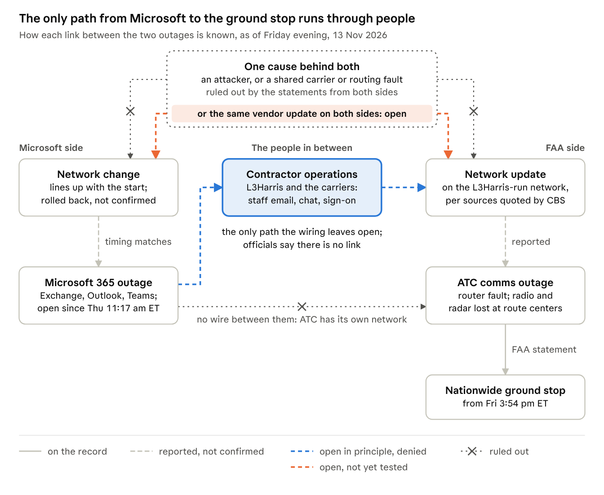

# Correlation, Causation, Cyberattack, Clusterfuck, or Just Friday the 13th?

> **Draft, as of Friday night, 13 November 2026.** The prose is a first pass and is being rewritten. The claims under it are not jokes: every section ends with a **Show the work** block you can click open for the arithmetic, the sources, and how far each source can be trusted. Every number comes out of [`scripts/show_your_work.py`](scripts/show_your_work.py).

First, the important fact: it was Friday the 13th. Every flight in the United States was grounded, a tanker ran into a riverboat in New Orleans, and the world's email had been down for a day. We will set this hypothesis aside for most of what follows, though the reader is free to carry a prior.

The serious version of the question is whether the Microsoft 365 outage that began on Thursday and the FAA ground stop that began on Friday have anything to do with each other. There are five candidate answers, and the title lists them in roughly ascending order of how much fun they are. Let us take them in order of how much evidence they have, which is a different order.

## What happened, briefly and without adjectives

Thursday, 11:17 am Eastern: Exchange Online stops opening mailboxes. Over the afternoon it takes Outlook, Teams, SharePoint and Copilot with it. Microsoft freezes all its own deployments at about 2 pm, spends the night restarting servers that fall over again the moment they see traffic, and by Friday morning is rolling back a network configuration change whose timing lines up with the start. It has not published a root cause. It has said, firmly, that this was not an attack.

Friday, 3:54 pm Eastern: the FAA grounds every departing flight in the country, the second time it has done so since 2001. The stated cause is a telecommunications outage affecting the en-route control centres. Multiple sources tell CBS that an update to the private air traffic network, run by L3Harris, made it reboot and crash. An airline source tells CNN it was a router problem that cascaded. The FAA has confirmed none of this. The ground stop lifts around 8:30 pm.

So: two production networks, two changes, two crashes, twenty-eight hours apart. Both organisations have said the events are not connected.

<details>
<summary><b>Show the work:</b> the timeline, and which parts are official</summary>

| When (Eastern) | Side | What happened | Standing |
| --- | --- | --- | --- |
| Thu 11:17 am | Microsoft | Exchange Online incident EX1550543 starts | Microsoft's incident record, via [LazyAdmin](https://lazyadmin.nl/office-365/microsoft-365-outage-november-2026/) |
| Thu 1:26 pm | Microsoft | Wider incident MO1550821 opens | [BleepingComputer](https://www.bleepingcomputer.com/news/microsoft/massive-microsoft-365-outage-disrupts-outlook-teams-copilot-worldwide/) |
| Thu about 2:06 pm | Microsoft | All deployments and configuration changes paused | [LazyAdmin](https://lazyadmin.nl/office-365/microsoft-365-outage-november-2026/) |
| Thu night into Fri | Microsoft | Rollback of a network configuration change begins | Microsoft calls the change correlated, not causal |
| Fri 3:54 pm | FAA | Nationwide ground stop takes effect | [News9](https://www.news9.com/oklahoma-city-news/faa-reportedly-issues-nationwide-ground-stop), [Gizmodo](https://gizmodo.com/faa-issues-nationwide-ground-stop-due-to-extraordinary-circumstances-2000839944) |
| Fri evening | FAA | Network-update account reported | Unnamed sources to one outlet, CBS; not confirmed by the FAA |
| Fri about 8:30 pm | FAA | Ground stop lifted | [The Register](https://www.theregister.com/offbeat/2026/11/13/faa-lifts-ground-stop-after-hours-long-delays-snag-travelers/5309912) |

The gap from the Exchange incident opening to the ground stop is 28 hours 37 minutes. The Microsoft incident was still open at that point, but 3 hours 48 minutes past the update in which Microsoft reported mail queues significantly reduced.

The full timeline, with a source on every row, is in [the analysis](analysis/independence-or-common-cause.md#timeline).

</details>

## Correlation

This is the one answer we can be sure of, and it is the least interesting. The two events are correlated in the only sense that matters to a headline writer: they happened close together. The question is whether that proximity is surprising.

Major Microsoft 365 outages run about three to four a year. The ground stop landed inside an open one, about 1.2 days in. Under independence, the chance of that overlap is somewhere between one and two percent, call it two sigma. Suggestive, if you squint.

But nobody picked Microsoft in advance. The same week had a German defence contractor breach, a bomb-hoax email campaign, a malware takedown, and whatever else was in the security newsletters. With ten candidate events that could have felt like a coincidence had they lined up, the chance that at least one does is around fifteen percent. That is not two sigma. That is a Tuesday.

There is a cleaner way to see it. The odds that the pairing is causal rather than coincidental equal epsilon divided by the product of the ground-stop rate and the window, where epsilon is the chance that a Microsoft outage contributes to a nationwide air traffic failure. The denominator is about one in 2,300. So the odds are even if epsilon is one in 2,300, and nobody knows epsilon to within three orders of magnitude. The historical record, roughly 45 major Microsoft outages and zero ground stops, bounds it below about seven percent, which is 150 times above the threshold. The data cannot tell zero from one in a thousand. The arithmetic will not settle this. Mechanism will.

<details>
<summary><b>Show the work:</b> the coincidence arithmetic</summary>

**The overlap.** Treat major Microsoft 365 outages as a Poisson process with rate $\lambda_M$ per year, each exposing $T$ days in which a ground stop would look paired with it. Conditioning on the ground stop,

```math
p_0 = 1 - e^{-\lambda_M T / 365}
```

| $\lambda_M$ | $T$ | $p_0$ | One-sided sigma |
| --- | --- | --- | --- |
| 3 per year | 1.2 days | 0.98% | 2.3 |
| 3 per year | 2 days | 1.63% | 2.1 |
| 4 per year | 2 days | 2.17% | 2.0 |

**Look-elsewhere.** With $k$ candidate events that would have felt just as striking,

```math
P(\text{at least one lines up}) = 1 - (1 - p_0)^k
```

For $k = 10$ that is 9.4%, 15.2% and 19.7% for the three rows above: about one sigma.

**The identity.** Let $\varepsilon$ be the probability that a major Microsoft 365 outage contributes to a nationwide air traffic network failure, $\lambda_G$ the background rate of nationwide ground stops, and $W$ the window. Caused pairs arrive at rate $\lambda_M \varepsilon$ and coincidental pairs at rate $\lambda_M \lambda_G W$, so $\lambda_M$ cancels:

```math
\frac{P(\text{caused} \mid \text{pair})}{P(\text{coincidence} \mid \text{pair})} = \frac{\varepsilon}{\lambda_G W}
```

With $\lambda_G = 2/25$ per year (two nationwide ground stops since 2001) and $W$ of two days, $\lambda_G W = 4.4 \times 10^{-4}$, about 1 in 2,300.

| $\varepsilon$ | Odds of a link | Probability of a link |
| --- | --- | --- |
| 1 in 50,000 | 0.05 | 4% |
| 1 in 10,000 | 0.23 | 19% |
| 1 in 2,300 | 1 | 50% |
| 1 in 1,000 | 2.3 | 70% |

**What history bounds.** Zero ground stops after roughly 45 earlier major outages gives $\varepsilon < 3/45 \approx 6.7\%$ by the rule of three, which is 152 times the even-odds threshold.

**What is assumed, not measured.** The outage rate is a first-pass count from search results, not from Microsoft's incident history. The figure of 45 is that rate over about 13 years, not a count. The value $k = 10$ is a guess at how many incidents that week would have felt like a coincidence. Details and the first-pass outage table are in [the analysis](analysis/independence-or-common-cause.md#second-pass-on-the-numbers).

</details>

## Causation

There is no wire. Air traffic control voice and data ride a private network that L3Harris runs for the FAA; it does not pass through Exchange Online, and a controller's radio does not care whether anyone's calendar loads. If Microsoft caused the ground stop, it did so through people.

That path is real but narrow. The contractors who run the FAA's network, L3Harris and the carriers, presumably have email, chat and single sign-on like everyone else. If those were degraded on Friday, a scheduled network update could have gone out with less coordination than usual, or been slower to roll back when it went wrong. This is the only path the wiring leaves open. Officials say there is no link. Nobody has said whether the contractors were affected at all. And by Friday afternoon the Microsoft incident was well into recovery, so any such effect would be a recovery-window effect, the weaker claim.

If you insist on a number: suppose a one-in-five chance the contractors' operations were still degraded, and that degraded operations make a failed update thirty percent more likely. The probability that Microsoft contributed is then about five percent. Plausible ranges for those two inputs span half a percent to fifteen. Taking the official denials at face value sets it to zero. Neither input is measured, and no report yet says the first one is above zero.

<details>
<summary><b>Show the work:</b> the one open path, and the five percent</summary>



**Probability of causation.** If the proximate cause was a network update, the question is the epidemiologist's: did the outage raise the risk that this update failed? With $d$ the probability the contractors' operations were still degraded on Friday afternoon and $RR$ the relative risk of a failed update under degraded operations,

```math
P(\text{Microsoft contributed}) = d \cdot \frac{RR - 1}{RR}
```

| $d$ | $RR$ | Result | After halving the odds for the denials |
| --- | --- | --- | --- |
| 0.2 | 1.3 | 4.6% | 2.4% |
| 0.05 | 1.1 | 0.5% | 0.2% |
| 0.3 | 2.0 | 15.0% | 8.1% |

Both inputs are assumptions. The factor of two for the denials is also an assumption.

**Sources.**

- The air traffic network is private and run by L3Harris: [CBS Texas](https://www.cbsnews.com/texas/news/faa-ground-stop-halts-flights-at-dfw-and-dallas-love-field-airports/), [The Register](https://www.theregister.com/offbeat/2026/11/13/faa-lifts-ground-stop-after-hours-long-delays-snag-travelers/5309912).
- Microsoft's denial, "no indication that the FAA nationwide ground stop is related": given separately to [NBC News](https://www.nbcnews.com/news/us-news/live-blog/live-updates-flights-grounded-faa-communications-outage-rcna609268) and to [PEOPLE](https://www.yahoo.com/news/us/articles/microsoft-denies-involvement-atc-outage-002719386.html). Two independent sources.
- Mullin's denial: reported by [CNN](https://www.cnn.com/2026/11/13/us/live-news/flights-ground-stop-faa); [Northeastern](https://news.northeastern.edu/2026/11/13/faa-ground-stop-telecommunications-issue/) repeats it and credits CNN. One source.
- Whether the contractors lost email, chat or sign-on: no report either way.

</details>

## Cyberattack

Ruled out by both sides on day one. Microsoft says no indication of malicious activity. Homeland Security Secretary Mullin says no indication of a nefarious act. Law enforcement sources told CNN the same.

These statements are worth exactly what day-one statements are worth. They were made while the cause of the FAA failure was still described as undetermined, so they report what was known, not what was found. The 2023 ground stop took days before anyone was confident. Still, the attacker hypothesis has to explain two very different failure signatures, one that looks like capacity and health checks, one that looks like a network update, and an actor producing both needs either access to two unrelated environments or a shared vendor between them. The second of those is the next section wearing a different hat. The first is the one branch that, if it turned out to be true, would make everyone in the field work this weekend. It is also the least likely.

<details>
<summary><b>Show the work:</b> who ruled it out, and on what</summary>

- Microsoft: no indication of malicious or cyber activity. [BleepingComputer](https://www.bleepingcomputer.com/news/microsoft/massive-microsoft-365-outage-disrupts-outlook-teams-copilot-worldwide/).
- Mullin: no indication, as of Friday, of a nefarious act. [CBS News](https://www.cbsnews.com/news/faa-issues-nationwide-ground-stop/).
- Law-enforcement sources: preliminarily not a cyberattack. [CNN](https://www.cnn.com/2026/11/13/us/live-news/flights-ground-stop-faa).
- The FAA had not confirmed any cause when the stop was lifted. [The Register](https://www.theregister.com/offbeat/2026/11/13/faa-lifts-ground-stop-after-hours-long-delays-snag-travelers/5309912).

The remark about the January 2023 ground stop (a corrupted NOTAM database, understood only after some days) is from memory and has not been re-checked here.

No probability is attached to this branch. Nothing in this repo measures it.

</details>

## Clusterfuck

This is the technical term for one upstream cause producing two downstream failures that look unrelated. It has two forms.

The first is a shared carrier or routing fault, and the denials cover it.

The second is the same vendor update applied on both sides, and the denials do not. Both organisations describe a network change shortly before their network fell over. If they run the same router or network-OS platform, and that vendor shipped a patch that week, one cause produces two failures with no wire between them. This is the CrowdStrike shape. "Not connected" is not the same as "we compared firmware versions," and on Friday evening nobody had.

As it happens, Arista published a critical advisory for its EOS routing software on November 10, fixable only by upgrading, with no hotfix. Nothing ties either outage to it. No report says the FAA network runs Arista equipment. But it is exactly the kind of thing that has people changing network software on a Friday, and it is the one hypothesis that is both open and cheaply testable: name the vendor and version of the change on each side. Match, and this is the answer. Mismatch, and it is two Friday failures. Neither organisation has named either.

<details>
<summary><b>Show the work:</b> the advisory, and the test nobody can run yet</summary>

**The advisory.** [Arista Security Advisory 0208](https://www.arista.com/en/support/advisories-notices/security-advisory/25030-security-advisory-0208), published 10 November 2026 and revised 12 November. CVE-2026-121289, CVSS 9.8: a crafted packet crashes the BGP agent in EOS, dropping the device's BGP sessions. Fixed only in new EOS releases; no hotfix. Arista says it knows of no exploitation and reports no customer outages.

**What this does and does not show.**

- It shows an industry-wide reason to be upgrading network software that week.
- It is not a patch with a known crash defect.
- No report says Microsoft's change or the FAA network's update was an EOS upgrade.
- No report says what equipment the FAA network runs.
- The scan behind this was two searches, not a sweep of every vendor.

**The test.** When Microsoft's post-incident report and an FAA or L3Harris account exist, compare the vendor and version of the change on each side. Neither exists as of this draft.

</details>

## Just Friday the 13th

The 13th contributed nothing. The Friday may have.

"Don't deploy on Friday" is the one superstition operations people actually hold, and unlike the calendar it comes with a mechanism. A change pushed late in the week meets the thinnest staffing and the longest gap to the next working day, so a fault that would have been caught and rolled back on a Tuesday morning gets to run. Microsoft, to its credit, froze its own deployments on Thursday afternoon. The reported FAA update went out the next day.

Except that holds for one side only. The FAA update is reported as going out on Friday. Nobody has said when Microsoft's change went out. Microsoft said only that a recent network configuration change "correlates with the start of impact," and the start of impact was Thursday, 11:17 am Eastern. That is when the symptoms appeared, not when the change shipped. Large fleets roll changes out in stages, so a change that left the door on Tuesday, which happened to be Patch Tuesday, could reach the configuration that mattered on Thursday without anyone lying. Thursday is the earliest the public record lets us place it; it is not the only place. On the Microsoft side the Friday story may be a Tuesday story, or a Wednesday story, and the Friday superstition does not cover those at all.

Microsoft told us what correlated, not what shipped.

> *[Dan's DOOM line goes here: "Sofa King," DANGERDOOM, The Mouse and the Mask.]*

The most economical reading of the whole affair is also the dullest: two production networks were changed by their owners and fell over, which is the commonest cause of large outages there is. Two draws from the same distribution are not a conspiracy. They are the distribution.

<details>
<summary><b>Show the work:</b> what the calendar can and cannot carry</summary>

- 13 November 2026 is a Friday. Patch Tuesday, the second Tuesday of the month, was 10 November. Both are checked in the script.
- Microsoft's wording on its change, "correlates with the start of impact", and the absence of a published root cause: [LazyAdmin](https://lazyadmin.nl/office-365/microsoft-365-outage-november-2026/), [DEV](https://dev.to/teamvoy/microsoft-outlook-outage-timeline-enterprise-response-26l8).
- Microsoft's deployment freeze at about 2:06 pm Eastern on Thursday: [LazyAdmin](https://lazyadmin.nl/office-365/microsoft-365-outage-november-2026/).
- The FAA-side update going out on Friday: CBS sources, as relayed by [Gizmodo](https://gizmodo.com/faa-issues-nationwide-ground-stop-due-to-extraordinary-circumstances-2000839944). Not confirmed by the FAA.

**Not yet backed.** The staged-rollout reading of Microsoft's timing is consistent with the public record, not supported by it: nothing public says when the change shipped. The "don't deploy on Friday" mechanism is an argument here, not a measurement; no dataset on change-failure rates by weekday is cited in this repo yet.

</details>

## So which is it?

- **Correlation:** yes, trivially.
- **Causation:** a narrow path through people, open in principle, denied, unmeasured, and worth a few percent on assumed inputs.
- **Cyberattack:** denied by everyone, least likely, highest stakes.
- **Clusterfuck:** the one live hypothesis the denials do not reach, and the one with a cheap test nobody can run yet.
- **Friday the 13th:** half right.

Everything above rests on Friday-night reporting. Microsoft's denial has two independent sources. Mullin's has been quoted everywhere but every quote credits CNN, so it is one account of one briefing. The network-update story is unnamed sources to one outlet. Microsoft's own rollback is something Microsoft calls correlated, not causal. The disciplined move is to write down what we believed on Friday and why, and revise once, when the root causes are published, rather than nudging the posterior every time an unconfirmed item lands.

Until then, the honest answer to the title is: the second one, possibly, through the fourth one, probably not, and the fifth one, in the sense that counts.

## What is in this repo

| Path | What it is |
| --- | --- |
| [`README.md`](README.md) | The piece: prose on top, the work underneath |
| [`analysis/independence-or-common-cause.md`](analysis/independence-or-common-cause.md) | The full working analysis, with every source and a list of what is unsourced |
| [`analysis/causal-diagram.png`](analysis/causal-diagram.png) | The block diagram of how each link is known |
| [`scripts/show_your_work.py`](scripts/show_your_work.py) | Reproduces every number above; standard library only |
| [`analysis/numbers-output.txt`](analysis/numbers-output.txt) | That script's output |
| [`HANDOFF.md`](HANDOFF.md) | What is still open |

To check the numbers: `python3 scripts/show_your_work.py`.
