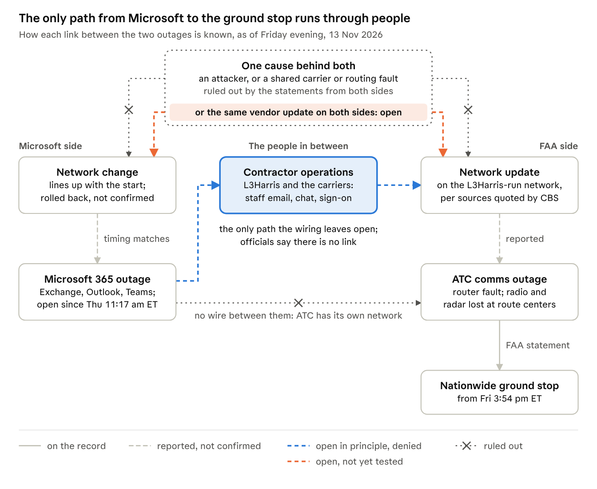

# Independence or Common Cause? The FAA Ground Stop and the Microsoft 365 Outage

First, the important fact: it was Friday the 13th. Every flight in the United States was grounded, a tanker ran into a riverboat in New Orleans, and the world's email had been down for a day. We will set this hypothesis aside for the rest of the document, though the reader is free to carry a prior.

## The big picture

As of Friday evening, November 13, the two outages look like separate failures of the same kind: on current reporting, each organisation changed its own network shortly before that network fell over. Officials say the two are not connected, nobody has reported a link, and the wiring leaves exactly one way Microsoft could have touched the ground stop: through the people who run the FAA's network, not through any cable.



Read it as two vertical chains, one per organisation, with three candidate bridges between them: a shared cause above (two forms ruled out; a third, the same vendor update on both sides, still open), a direct wire across the middle (there is none), and the contractors' own offices (the dashed path, open in principle and denied on the day).

### What each link rests on

| Link | Standing | Rests on |
| --- | --- | --- |
| ATC communications outage → ground stop | On the record | The FAA: "a temporary telecommunications outage", with all flights halted "out of an abundance of caution" ([AIN](https://www.ainonline.com/aviation-news/air-transport/2026-11-13/citing-communication-fault-faa-issues-us-ground-stop)). Duffy: a communication issue impacting all Air Route Traffic Control Centers ([CBS News](https://www.cbsnews.com/news/faa-issues-nationwide-ground-stop/)). |
| Network update → ATC communications outage | Reported, not confirmed | Multiple sources to CBS: an update to the private network linking air traffic control made it reboot and crash; L3Harris operates it ([CBS Texas](https://www.cbsnews.com/texas/news/faa-ground-stop-halts-flights-at-dfw-and-dallas-love-field-airports/)). An airline source to CNN: the FAA blamed network routers, and the fault cascaded nationwide ([CNN](https://www.cnn.com/2026/11/13/us/live-news/flights-ground-stop-faa)). Officially the cause is undetermined; Mullin's wording was "as of right now". |
| Microsoft network change → Microsoft 365 outage | Correlated, not confirmed | Microsoft is rolling back a recent network configuration change whose timing matches the start; the incident record still shows no root cause ([LazyAdmin](https://lazyadmin.nl/office-365/microsoft-365-outage-november-2026/), [DEV](https://dev.to/teamvoy/microsoft-outlook-outage-timeline-enterprise-response-26l8)). |
| Microsoft outage → ATC network, by wire | No such wire | Air traffic communications ride a private network run by L3Harris ([CBS Texas](https://www.cbsnews.com/texas/news/faa-ground-stop-halts-flights-at-dfw-and-dallas-love-field-airports/)); Microsoft's failure was in its own Exchange Online servers ([BleepingComputer](https://www.bleepingcomputer.com/news/microsoft/massive-microsoft-365-outage-disrupts-outlook-teams-copilot-worldwide/)). |
| One cause behind both | Ruled out by statements | Microsoft: no indication of malicious or cyber activity ([BleepingComputer](https://www.bleepingcomputer.com/news/microsoft/massive-microsoft-365-outage-disrupts-outlook-teams-copilot-worldwide/)). Mullin: "no indication, as of yet, that this was a nefarious act" ([CBS News](https://www.cbsnews.com/news/faa-issues-nationwide-ground-stop/)). Law-enforcement sources to CNN: preliminarily not a cyberattack ([CNN](https://www.cnn.com/2026/11/13/us/live-news/flights-ground-stop-faa)). |
| Microsoft outage → contractor operations → the update | Open in principle, denied | Mullin said the two incidents are not connected ([CNN](https://www.cnn.com/2026/11/13/us/live-news/flights-ground-stop-faa), [Northeastern](https://news.northeastern.edu/2026/11/13/faa-ground-stop-telecommunications-issue/)). Microsoft: "no indication that the FAA nationwide ground stop is related to the recent service disruption" ([NBC News](https://www.nbcnews.com/news/us-news/live-blog/live-updates-flights-grounded-faa-communications-outage-rcna609268)). No report says whether the contractors' own email, chat or sign-on were affected. |
| The same vendor update on both sides | Open, not yet tested | Added in the second text pass. Neither side has named a vendor or version, so the comparison cannot be run. One candidate that week: Arista's EOS advisory of November 10; nothing ties either outage to it. The denials do not reach this branch. Microsoft's statement now has a second source (PEOPLE); Mullin's still rests on CNN alone. Sources under Check results below. |

### Where the uncertainty sits

- **In two unpublished root causes, not in the statistics.** Microsoft has promised a post-incident report; the FAA and L3Harris have given no official account of the update. Those two documents settle the two dashed vertical links, and with them most of the question.
- **In how much weight same-day denials carry.** Taken as given, which is the ground rule here, they close the last bridge. They were also made while the cause was still described as undetermined, so they report what was known, not what was found.
- **In one narrow, untested question.** Did losing email, chat or sign-on make Friday's network update more likely to go wrong, or slower to roll back? Nothing public says the contractors were affected at all. By Friday afternoon the Microsoft incident was still open but well into recovery (see Timeline), so any such effect would be a recovery-window effect, the weaker claim.

**A third common cause, now drawn in the diagram: the same update.** Both sides describe a network change shortly before their network fell over. If Microsoft and L3Harris run the same router or network-OS platform and that vendor shipped a patch that week, one upstream cause produces two unconnected-looking failures with no wire between them. This is the CrowdStrike shape, a single vendor update reaching unrelated customers, and it is the one common cause the day-one denials do not reach: "not connected" would not catch a shared firmware version nobody had yet compared. The reporting cuts against it but does not close it. Microsoft calls its change a network configuration change of its own and is reverting something it did, not something pushed to it; the FAA's is described only as an update to the private network, which could be either. The test is cheap once the root causes exist: name the vendor and version in each. A match is strong evidence; a mismatch closes the branch.

- [ ] When Microsoft's post-incident report and an FAA or L3Harris account appear, compare the vendor and version of the change on each side.
- [x] Check vendor advisories for the week of November 9 for a network-OS or router patch with a known reboot or crash defect.

**Check results, Friday night (second text pass).**

- **Vendor and version: cannot be run yet.** Neither side has named a vendor, product or version. The Register, opened in full, reports that the FAA has not confirmed a reason, L3Harris has not commented, and the CBS update account is the only cause described ([The Register](https://www.theregister.com/offbeat/2026/11/13/faa-lifts-ground-stop-after-hours-long-delays-snag-travelers/5309912)). Microsoft's incident records showed no root cause at last check.
- **Advisory scan: one candidate, nothing tying it to either outage.** Arista published Security Advisory 0208 on November 10 and revised it on November 12: a critical flaw in the EOS routing software (CVE-2026-121289, CVSS 9.8), fixed only by upgrading to a new EOS release, with no hotfix ([Arista](https://www.arista.com/en/support/advisories-notices/security-advisory/25030-security-advisory-0208)). That gave operators of Arista equipment a reason to be changing network software that week. It is not a patch with a known crash defect, Arista reports no customer outages, and no report says either side's change was an EOS upgrade or that the FAA network runs Arista equipment. From memory and not checked here: Arista's annual reports have long listed Microsoft among its largest customers. A Cisco firewall crash flaw patched in October turned up by headline only ([The Hacker News](https://thehackernews.com/2026/10/cisco-patches-actively-exploited-asa.html)). The scan was two searches, not a sweep of every vendor.
- **Second source for Microsoft's statement: found.** A Microsoft spokesperson gave PEOPLE the same sentence NBC carried, word for word ([PEOPLE via Yahoo](https://www.yahoo.com/news/us/articles/microsoft-denies-involvement-atc-outage-002719386.html), opened in full).
- **Second source for Mullin's statement: not found.** Northeastern's page, opened in full, quotes him saying "Those are separate issues", but credits the words to CNN ([Northeastern](https://news.northeastern.edu/2026/11/13/faa-ground-stop-telecommunications-issue/)). The denial still rests on one outlet's account of a White House briefing. No transcript or wire story could be opened; two wire-style pages refused the fetch.
- **Also new.** The ground stop was lifted at about 8:30 pm Eastern, after about five hours ([The Register](https://www.theregister.com/offbeat/2026/11/13/faa-lifts-ground-stop-after-hours-long-delays-snag-travelers/5309912)). PEOPLE relays a Washington Examiner report of a "rolling frequency" issue, citing two FAA sources.

The most economical reading is also the dullest: two draws from the commonest cause of large outages, a change to a production network. Microsoft froze all of its own deployments and configuration changes on Thursday afternoon ([LazyAdmin](https://lazyadmin.nl/office-365/microsoft-365-outage-november-2026/)). The update on the FAA side went out the next day, a Friday, and the 13th at that.

The straight answer is that the day of the month is irrelevant and the day of the week is not. "Don't deploy on Friday" is the one superstition operations people actually hold, and it has a mechanism: a change pushed late in the week meets the thinnest staffing and the longest time to the next working day, so a fault that would have been caught and rolled back on a Tuesday morning gets to run. The 13th contributed nothing. The Friday afternoon may have.

## Timeline

The ground stop began 28 hours 37 minutes after Microsoft's Exchange incident opened. That incident was still open, but nearly four hours past the point where Microsoft reported mail queues significantly reduced. All times Eastern.

| When (ET) | Side | What happened | Source |
| --- | --- | --- | --- |
| Thu 12 Nov, 9:45 to 10:53 am | Microsoft | Separate Teams incident (TM1550488), Americas only; resolved | [LazyAdmin](https://lazyadmin.nl/office-365/microsoft-365-outage-november-2026/) |
| Thu 11:17 am | Microsoft | Exchange Online incident EX1550543 starts; users cannot open mailboxes | [LazyAdmin](https://lazyadmin.nl/office-365/microsoft-365-outage-november-2026/) |
| Thu 1:26 pm | Microsoft | Wider incident MO1550821 opens: Teams, SharePoint, Copilot, Defender | [BleepingComputer](https://www.bleepingcomputer.com/news/microsoft/massive-microsoft-365-outage-disrupts-outlook-teams-copilot-worldwide/) |
| Thu about 2:06 pm | Microsoft | Microsoft pauses all deployments and configuration changes | [LazyAdmin](https://lazyadmin.nl/office-365/microsoft-365-outage-november-2026/) |
| Thu 7:00 pm | Microsoft | Restored servers go unresponsive again once they take traffic | [LazyAdmin](https://lazyadmin.nl/office-365/microsoft-365-outage-november-2026/) |
| Thu 11:22 pm | Microsoft | Partial recovery in some regions, not sustained | [LazyAdmin](https://lazyadmin.nl/office-365/microsoft-365-outage-november-2026/) |
| Thu night into Fri | Microsoft | Begins rolling back a recent network configuration change whose timing matches the start | [LazyAdmin](https://lazyadmin.nl/office-365/microsoft-365-outage-november-2026/) |
| Fri 13 Nov, 8:05 am | Microsoft | Services reported gradually recovering | [BleepingComputer](https://www.bleepingcomputer.com/news/microsoft/massive-microsoft-365-outage-disrupts-outlook-teams-copilot-worldwide/) |
| Fri 12:06 pm | Microsoft | Email queues significantly reduced | [Control Plane](https://controlplane.com/blog/post/microsoft-365-outage-november-2026-cause) |
| Fri 3:54 pm | FAA | Nationwide ground stop takes effect; about 3,100 aircraft airborne for U.S. airports | [News9](https://www.news9.com/oklahoma-city-news/faa-reportedly-issues-nationwide-ground-stop), [Gizmodo](https://gizmodo.com/faa-issues-nationwide-ground-stop-due-to-extraordinary-circumstances-2000839944), [AIN](https://www.ainonline.com/aviation-news/air-transport/2026-11-13/citing-communication-fault-faa-issues-us-ground-stop) |
| Fri 4:16 pm | FAA | Duffy: a communication issue impacting all Air Route Traffic Control Centers | [Clash Report](https://clashreport.com/world/articles/faa-orders-nationwide-ground-stop-citing-extraordinary-circumstances-rj94ktbb7uf) |
| Fri evening | Both | Mullin: no sign of a nefarious act, and not connected to the Microsoft outage. Microsoft: no indication the two are related | [CNN](https://www.cnn.com/2026/11/13/us/live-news/flights-ground-stop-faa), [NBC News](https://www.nbcnews.com/news/us-news/live-blog/live-updates-flights-grounded-faa-communications-outage-rcna609268) |
| Fri about 6:40 pm | FAA | Ground stop still in effect; departures to resume as en-route facilities recover | [ABC7](https://abc7.com/live-updates/faa-ground-stop-live-updates-what-know-nationwide-flights-are-grounded/20038887/) |
| Fri about 6:45 pm | FAA | CBS reports the network-update account, citing multiple sources | [Gizmodo](https://gizmodo.com/faa-issues-nationwide-ground-stop-due-to-extraordinary-circumstances-2000839944) |
| Fri about 8:30 pm | FAA | Ground stop lifted after about five hours; no official cause given | The Register (link under Check results) |

Microsoft's two incident records were still open, with no root cause, at last check on November 14 ([DEV](https://dev.to/teamvoy/microsoft-outlook-outage-timeline-enterprise-response-26l8)). No report found says the FAA or its network contractors were themselves among the organisations that lost Microsoft 365.

## Setup

Two major infrastructure failures landed within about a day of each other in November 2026:

- **Microsoft 365 outage.** Outlook, Exchange Online and Teams disrupted from 11:17 am ET on Thursday, November 12, and still open when the ground stop began 28 hours later. Microsoft described servers failing health checks and an overwhelmed secure-connection process, began rolling back a recent network configuration change, has published no root cause, and stated there was no indication of malicious or cyber activity.
- **FAA nationwide ground stop.** Issued the afternoon of November 13 after a telecommunications issue affecting Air Route Traffic Control Centers. Only the second nationwide ground stop since 9/11 (the previous was January 2023, a corrupted NOTAM database). Officials said the issue was not a cyberattack but were "not ruling out anything."

Both are officially "not an attack." Note what the statements do and do not rule out: Microsoft's account excludes an attack on Microsoft, and the FAA's excludes an attack on the FAA, and by Friday evening both sides had also addressed the link itself: Homeland Security Secretary Markwayne Mullin said the two incidents are not connected, and a Microsoft spokesperson said the company has no indication the ground stop is related to its disruption. Those are same-day statements, made while the cause of the FAA failure was still described as undetermined, so they are evidence rather than a finding. A telecom failure is fully compatible with a Microsoft-related cause, since the carriers and contractors managing those circuits may run their own operations and coordination through Microsoft tooling. As a problem in inference the question still stands: are they *independent*, or do they share a *common cause* (a shared carrier, routing, DNS, cloud dependency, or a single actor)?

## The question, stated properly

Let H0 be the hypothesis that the two events are independent, and H1 that they share a common cause. Let D be the observation "both occurred within a window of w days." We want the posterior odds, which factor as a Bayes factor times prior odds:

```math
\frac{P(H_1 \mid D)}{P(H_0 \mid D)} = \frac{P(D \mid H_1)}{P(D \mid H_0)} \cdot \frac{P(H_1)}{P(H_0)}
```

The data alone cannot give a probability of relatedness. It gives a Bayes factor; the prior does the rest. With only two events, the prior dominates, and the exercise is mostly about being honest regarding how much each piece contributes.

## Base rates (rough, to be refined)

- **Nationwide ground stops.** Two in the roughly 25 years since 9/11, so the rate lambda\_G is about 0.08 per year. Rare enough that we condition on it having happened rather than modelling it.
- **Major Microsoft 365 outages.** Multi-hour, multi-service, widely reported outages run on the order of 4 to 6 per year. Take lambda\_M to be about 5 per year, so roughly 0.014 per day.

## Coincidence under independence

Condition on the ground stop. Under H0, model major Microsoft outages as a Poisson process with rate lambda\_M. The probability that at least one falls within plus or minus one day (a two-day window) is

```math
P(D \mid H_0) = 1 - e^{-2\lambda_M / 365} \approx 1 - e^{-0.027} \approx 0.027
```

So roughly a 3% coincidence, a nominal p-value of about 0.03. Suggestive on its own, but see the correction below.

A tighter version: treat the Microsoft outage as an interval of 22 hours and ask for the probability that the ground stop's start time falls inside or within a few hours of that interval. Same order of magnitude; the exact number depends on how you define "within."

## Likelihood under a common cause

If there is a shared cause, how likely is it that both failures appear within the window? This is the number people quietly skip. Call it q. For a tightly coupled dependency (same carrier failing at the same moment), q is high, maybe 0.7 or more. For a looser coupling (a shared vendor degraded over several days), q might be 0.3. So the Bayes factor is

```math
\mathrm{BF} = \frac{q}{0.027} \approx 10 \text{ to } 30
```

## Prior odds

How often do two major, unrelated-looking infrastructure failures in the same week turn out to share a cause? Historically, not often. The 2023 ground stop had no sibling; most Microsoft outages are internal. A prior P(H1) somewhere between 1 in 200 and 1 in 50 seems defensible, giving prior odds of about 0.005 to 0.02.

## Posterior

```math
\text{posterior odds} \approx (10 \text{ to } 30) \times (0.005 \text{ to } 0.02) \approx 0.05 \text{ to } 0.6
```

So P(H1 | D) lands somewhere between about 5% and 37%. That range is wide because it is almost entirely determined by the two numbers we guessed, q and the prior. The observed coincidence moves things by a factor of ten to thirty, which is real but not decisive.

*Note, November 13, later the same day: left as first written. Three later reports bear on this estimate: same-day denials of any link, an account that a network update caused the FAA failure, and Microsoft's rollback of a network change of its own. None is settled. Mullin's denial reaches us only through CNN, whose page could not be read in full; the update account comes from unnamed sources to one outlet, CBS; and Microsoft calls its change correlated, not causal. This section will be revised once, when the root causes are published and the statements confirmed. The Second pass section further down is a parallel look at the arithmetic, not a replacement.*

## The look-elsewhere correction

The 3% figure assumed we picked the Microsoft outage *before* looking. We did not. There were many notable incidents the same week (a German defence contractor breach, bomb-hoax email campaigns, a malware takedown, assorted regional outages). If there were k candidate events that would have felt like a coincidence had they lined up, the chance that at least one does so under H0 is

```math
1 - (1 - 0.027)^k
```

which for k = 10 is about 24% and for k = 20 about 42%. Once you account for the selection, the coincidence is unremarkable. This is the Texas sharpshooter problem, and it is the single biggest reason two-event stories mislead.

## Tools in the kit

- **Poisson coincidence test.** The calculation above. Good for "is this overlap surprising" questions; cheap and transparent.
- **Bayes factor / likelihood ratio.** The right frame for comparing independence against a common cause. Forces you to state q and the prior explicitly.
- **Fisher's exact test.** If you build a contingency table of days with and without FAA incidents against days with and without Microsoft incidents over several years, this tests association without Poisson assumptions.
- **Hawkes (self-exciting point) process.** Given a long log of infrastructure failures, tests whether events cluster, that is whether one failure raises the short-term rate of others. This is the proper tool for "do outages come in waves."
- **Granger causality.** The time-series analogue, asking whether one outage series predicts another. Needs far more than two events.
- **Dependency-graph analysis.** Not statistical at all, and the one that actually discriminates here. Enumerate what the FAA's ARTCC telecom and Microsoft's affected infrastructure both depend on: carriers, peering points, DNS providers, certificate authorities, cloud regions. A shared node is evidence; none is strong evidence for H0.

## Exercises

1. **Sensitivity.** Recompute P(D | H0) for lambda\_M from 2 to 12 per year and windows of 1, 2 and 3 days. How much does the conclusion move?
2. **Intervals, not points.** Replace the point-coincidence model with interval overlap. Define the Microsoft outage as the interval from t0 to t0 plus 22 hours and compute the probability the ground stop's start falls within delta hours of that interval under H0.
3. **Value of information.** Which single new observation would move the posterior the most? Candidates: the FAA naming a specific telecom vendor; Microsoft publishing a root cause with a named upstream; a third large outage in the same window.
4. **Build the graph.** Sketch the shared-dependency graph. Which nodes, if they failed, would plausibly produce *both* symptoms, and which would produce only one?
5. **Calibrate the prior.** Go through the last ten years of major U.S. infrastructure outages and count how many pairs within 48 hours later turned out to share a cause. That empirical rate is your prior.

## Operational dependency: the contractors behind the FAA network

If both official accounts are accepted, the direct data-plane link from Microsoft 365 to air traffic communications has no mechanism: controller voice and data ride on a dedicated network, not on Office 365. The remaining path is operational. The contractors who run that network use ordinary enterprise tooling (ticketing, monitoring, change management, and identity) and if any of that sits on Microsoft 365 or Entra, an outage could degrade detection and response, or leave a scheduled change uncoordinated. That is a claim that Microsoft *degraded the response*, not that it caused the fault. It raises q from near zero to a few percent, depending on how much of the contractors' operations stack depends on Microsoft, which is unknown.

The contractor picture is mid-transition, which is where operational dependencies bite hardest:

| Role | Contractor | Detail | Source |
| --- | --- | --- | --- |
| Legacy network (FTI) | L3Harris | Implemented 2002; connects about 4,400 government sites; the Verizon announcement cites 5,000 facilities and 30,000 circuits | [telecoms.com](https://www.telecoms.com/5g-6g/verizon-bags-2-billion-faa-deal), [Verizon](https://www.verizon.com/about/news/verizon-public-sector-wins-federal-aviation-administration-fens-contract) |
| Successor network (FENS), original prime | Verizon | $2.4 billion, 15-year award in March 2023 | [Telecom Review Americas](https://www.telecomreviewamericas.com/articles/telecom-operators/att-to-drive-faas-next-generation-communications-backbone/) |
| FENS, current prime | AT&T | Took over as lead project manager and prime in August 2026; Verizon moved to a supporting role providing core network functions; $74.3 million initial award; December 2028 operational deadline | [Washington Technology](https://www.washingtontechnology.com/contracts/2026/08/faa-brings-t-network-modernization-program/415412/), [Omni Flights](https://omniflights.com/articles/faa-awards-att-743m-air-traffic-network-contract) |

Three organisations with a hand in the network, one of them only three months into the lead role, also fattens the "boring internal failure" prior on its own.

## Government impact from this outage

The operational-dependency path is not hypothetical: this outage demonstrably reached government operations.

- The U.S. House of Representatives said the outage disrupted services for some users and that it was working with Microsoft to resolve it: [CTech](https://www.calcalistech.com/ctechnews/article/ae7fhicvr)
- Australia's intelligence agency ASIO and the Australian Federal Police were affected: [Yahoo Finance UK](https://uk.finance.yahoo.com/news/major-organisations-impacted-microsoft-outage-111317966.html)
- Japan's Deputy Chief Cabinet Secretary confirmed parts of the government's IT infrastructure were hit: [Yahoo Finance UK](https://uk.finance.yahoo.com/news/major-organisations-impacted-microsoft-outage-111317966.html)
- Immigration New Zealand paused processing of all visa applications: [Newsweek](https://www.newsweek.com/microsoft-outage-hits-global-operations-from-airlines-to-visas-12708940)
- The outage lasted more than 18 hours and raised questions about Department of Defense exposure after a $9.7 billion software deal: [Newsweek](https://www.newsweek.com/microsoft-outage-comes-after-pentagon-signed-9-7b-software-deal-12709859)
- Airlines warned customers of communication lags: [RTE](https://www.rte.ie/news/business/2026/1113/1599061-microsoft-tech-outage/)
- Microsoft described the cause as unexpectedly unavailable servers and infrastructure capacity issues, with Exchange Online at the centre: [yourNEWS](https://yournews.com/2026/11/13/7265764/microsoft-365-outage-disrupts-governments-and-businesses-worldwide-as-outlook/)
- Precedent: the 2024 CrowdStrike incident on Windows grounded flights, took TV stations off air, and disrupted hospital systems: [TIME](https://time.com/article/2026/11/13/microsoft-outage-worldwide-disruption-teams-outlook-emails/)

## Replacing guesses with measurable numbers

Three quantities in the posterior can be estimated from data rather than assumed. Together they give a bottom-up estimate of q, the probability that a Microsoft outage of this kind contributes to a failure like the ground stop.

**1. Coupling probability, c.** The chance the FAA's network contractors (L3Harris, Verizon, AT&T) run their operations tooling on Microsoft 365 or Entra. Federal and large-contractor adoption of Microsoft 365 is very high, so c is plausibly 0.8 or more. Measurable from FedRAMP authorisations, contractor disclosures, or job postings naming the tooling.

**2. Per-exposure failure rate, r.** Of organisations that lost Microsoft 365 for roughly 22 hours this week, what fraction suffered a serious operational failure as a result? This outage is itself the sample: tens of thousands of organisations exposed, a few dozen documented operational failures. That puts r on the order of 0.001 per organisation. Measurable by counting documented failures against Microsoft's reported tenant exposure.

**3. Historical conversion rate, h.** Across major cloud and identity outages in the last five years, how many produced a documented aviation or critical-infrastructure failure? CrowdStrike 2024 is one clear case. Build the table; the ratio is probably a handful out of thirty or forty outages, giving h of roughly 0.05 to 0.15. This is the cleanest empirical prior for the question.

A first-pass estimate of the Microsoft-contributed probability is then

```math
q_{\text{ops}} \approx c \cdot r \cdot a
```

where a is an adjustment for the FAA being unusually dependent on real-time coordination during a change window (a greater than 1, perhaps 3 to 10). With c of 0.8, r of 0.001 and a of 5, that is about 0.004, well under one percent. The historical rate h is a sanity check on the same quantity from the other direction: if h is 0.1 but the bottom-up estimate is 0.004, one of the two counts is wrong, most likely because "critical-infrastructure failure" is being defined differently in each.

*Note, November 13, later the same day: left as first written. The Second pass section argues that this product measures a different event from the one the question needs, and the reported network-update account would change which calculation applies. That account is from unnamed sources to one outlet and is not confirmed by the FAA, so the estimate stands here until the root causes are published.*

| Quantity | Current value in this doc | Replace with | Where to get it |
| --- | --- | --- | --- |
| Microsoft major outage rate | 4 to 6 per year (memory) | Count of multi-hour, multi-service incidents | Microsoft 365 service health history, Downdetector archives |
| Coupling c | Not estimated | Fraction of FAA network contractors on M365 or Entra | FedRAMP marketplace, contractor disclosures |
| Per-exposure failure rate r | Not estimated | Documented operational failures divided by exposed organisations | News coverage of this outage, Microsoft tenant counts |
| Historical conversion h | Not estimated | Outages that caused critical-infrastructure failures divided by major outages | Five-year list of cloud and identity outages |
| Look-elsewhere count k | 10 to 20 (guess) | Count of notable incidents in the same week | Security news roundups for the week |

- [ ] Build the five-year outage table for h.
- [ ] Count documented operational failures from this outage for r.

## First pass: Microsoft 365 major outage count

A rough count from search summaries on November 13, 2026, not from reading each page. Only widely reported, multi-hour, multi-service incidents are listed; minor single-feature incidents (of which there are dozens a month) are excluded.

| Date | Incident | Duration | Source |
| --- | --- | --- | --- |
| Nov 12 to 13, 2026 | Exchange Online, Outlook, Teams, Copilot; global | over 28 hours and still open at the ground stop | [Reuters factbox](https://www.streetinsider.com/Reuters/Factbox-Major+tech+outages+in+recent+years/27339389.html) |
| Aug 31, 2026 | Exchange Online degraded; about 4,600 Downdetector reports | not stated | [Hollywood Life summary of CNBC](https://hollywoodlife.com/feature/how-many-microsoft-outages-over-the-years-5583241/) |
| Aug 17, 2026 | Search degraded across SharePoint, OneDrive, Outlook | about 3 days | [StatusGator](https://statusgator.com/services/microsoft-365-suite/outage-history) |
| Jan 22 to 23, 2026 | Outlook send and receive failures during U.S. business hours (MO1221364) | nearly 11 hours | [SourceIT](https://sourceit.com.sg/blogs/news/microsoft-365-outage-history-how-often), [Hollywood Life](https://hollywoodlife.com/feature/how-many-microsoft-outages-over-the-years-5583241/) |
| Oct 2025 | Azure configuration change rippled into Microsoft 365; Alaska Airlines systems disrupted | not stated | [Hollywood Life summary of CNBC](https://hollywoodlife.com/feature/how-many-microsoft-outages-over-the-years-5583241/) |
| Mar 1, 2025 | Outlook and Exchange failure from a code change | weekend | [Medha Cloud](https://medhacloud.com/blog/microsoft-365-outage-history) |

That is about 3 to 4 major incidents per year over the last two years, lower than the 4 to 6 assumed above. One independent analysis puts it at 2 to 3 significant outages per year and roughly one 4-hour-plus outage every 18 to 24 months: [Medium, Kovvuru](https://medium.com/@ismailkovvuru/microsoft-365-outage-2026-root-cause-forensic-analysis-77712e57b9fc). A lower rate makes the coincidence slightly more surprising: at 3 per year, the two-day window probability under independence falls from about 2.7% to about 1.6%, still under 2.5 sigma one-sided and still swamped by the look-elsewhere correction.

Note also the October 2025 entry: a Microsoft-ecosystem outage with a documented airline impact. That is a second data point for the historical conversion rate h, alongside CrowdStrike 2024.

*Note, November 13, later the same day: the count and the rate are left as first written; they have not been redone from incident records. One cell was changed in the first text pass, before the instruction to leave earlier analysis in place: this week's duration, from about 22 hours to over 28, because the incident was still open. Later reporting on the cause of this week's outage (a network change Microsoft calls correlated, not causal) does not yet alter the count.*

## Second pass on the numbers

Two estimates already in this doc disagree by one to two orders of magnitude, and the identity below shows why. Every input here is still an assumption; the point is to show where the assumptions bite.

**The coincidence, re-measured.** The ground stop fell inside an open major incident, about 1.2 days after it began. With 3 to 4 major incidents a year and 1.2 to 2 days of exposure per incident, the chance under independence is 1.0% to 2.2%, or 2.0 to 2.3 sigma one-sided. With ten candidate pairings that week it becomes 9% to 20%, about one sigma.

**The identity that ties the estimates together.** Let epsilon be the probability that a major Microsoft 365 outage contributes to a nationwide air traffic network failure, lambda\_G the background rate of nationwide ground stops, and W the window. Caused pairs arrive at rate lambda\_M times epsilon, coincidental pairs at lambda\_M times lambda\_G times W, so the Microsoft outage rate cancels:

```math
\frac{P(\text{caused} \mid \text{pair})}{P(\text{coincidence} \mid \text{pair})} = \frac{\varepsilon}{\lambda_G W}
```

With lambda\_G of 0.08 per year and W of two days the denominator is 4.4 in 10,000, so the odds are even at an epsilon of about 1 in 2,300.

| Epsilon | Odds of a link | Probability of a link |
| --- | --- | --- |
| 1 in 50,000 | 0.05 | 4% |
| 1 in 10,000 | 0.23 | 19% |
| 1 in 2,300 | 1 | 50% |
| 1 in 1,000 | 2.3 | 70% |
| 1 in 250 (the bottom-up c times r times a above) | 9.1 | 90% |

**Why the doc disagreed with itself.** The Posterior section's odds of 0.05 to 0.6 correspond to an epsilon between 1 in 46,000 and 1 in 3,800. The bottom-up product c times r times a came to 1 in 250, which this identity turns into nine-to-one odds *for* a link, not the "well under one percent" claimed for it. The product was answering a different question: r counts any serious operational failure at an exposed organisation, while epsilon needs that failure to be a nationwide air traffic network crash. A further factor well below one is missing, and nothing here measures it.

**What history can bound.** Roughly 45 major Microsoft 365 outages preceded this one (approximate: the rate above over about 13 years, not a count), none followed by a nationwide ground stop. Zero in 45 bounds epsilon below about 7% by the rule of three, some 150 times above the 1-in-2,300 threshold. The record cannot tell an epsilon of zero from one of 1 in 1,000. The whole question lives where the data cannot reach, which is why mechanism decides it and the coincidence does not.

**Given that an update did it.** If the proximate cause was a network update, the question becomes the epidemiologist's probability of causation: did the outage raise the risk that this update failed? Let d be the probability the contractors' operations were still degraded on Friday afternoon, and RR the relative risk of a failed update under degraded operations.

```math
P(\text{Microsoft contributed}) = d \cdot \frac{RR - 1}{RR}
```

With d of 0.2 and RR of 1.3 that is about 5%. Plausible ranges (d from 0.05 to 0.3, RR from 1.1 to 2) span 0.5% to 15%. Taking the official denials fully at face value sets it to zero; treating them as evidence worth a factor of two on the odds gives about 2%. Neither d nor RR is measured, and no report yet says d is above zero.

## Sources and basis for each claim

Sourced claims below link to the page the statement came from. These were taken from search-result summaries on November 13, 2026, not from reading each page in full, so verify before relying on a figure.

**FAA ground stop (November 13, 2026)**

- Nationwide ground stop for all U.S. airports following a communication issue impacting all Air Route Traffic Control Centers, per Transportation Secretary Sean Duffy: [Scripps News](https://www.scrippsnews.com/us-news/faa-issues-nationwide-ground-stop-on-us-air-traffic), [CBS News](https://www.cbsnews.com/news/faa-issues-nationwide-ground-stop/), [Axios](https://www.axios.com/2026/11/13/faa-nationwide-ground-stop)
- Nationwide ground stops are extremely rare; the last was January 2023 after a failure of a pilot communication system: [CNBC](https://www.cnbc.com/2026/11/13/faa-ground-stop.html)
- Described as a telecommunication outage; officials "not ruling out anything at this point": [NBC News](https://www.nbcnews.com/news/us-news/faa-orders-nationwide-ground-stop-departing-flights-reasons-safety-rcna609247)
- FAA says the communications issue is not a cyberattack; second nationwide ground stop since 9/11: [Fox News front page](https://www.foxnews.com/)
- White House: no indication of a "nefarious act": [CBS News](https://www.cbsnews.com/news/faa-issues-nationwide-ground-stop/)

**Microsoft 365 outage (November 12 to 13, 2026)**

- About 22 hours of disruption to Microsoft 365, Teams and Outlook; Microsoft confirmed it was not linked to a cyberattack: [Yahoo Tech](https://tech.yahoo.com/cybersecurity/articles/microsoft-outage-updates-cyberattack-company-145215239.html)
- Cause described as overloaded servers and configuration challenges; Microsoft statement that there is no indication of malicious or cyber activity: [TechRadar live blog](https://www.techradar.com/news/live/outlook-outage-nov-2026)
- Outlook, Exchange Online and Teams affected; Microsoft investigating server failures: [SecurityWeek](https://www.securityweek.com/microsoft-365-outage-disrupts-outlook-exchange-online-and-teams/)
- Knock-on effects: UK police lost online crime reporting, NHS email prescription delays, government email down in Singapore and Japan: [HBS, This Week in Cybersecurity](https://www.hbs.net/cybersecurity-weekly/this-week-in-cybersecurity-november-13-2026)

**Other incidents the same week (for the look-elsewhere count)**

- German defence contractor Quantum Systems confirmed an active cyberattack by hostile actors disrupting military drone operations: [BleepingComputer](https://www.bleepingcomputer.com/news/security/german-military-drone-operations-disrupted-by-cyberattack/)
- Bomb-hoax emails from hijacked inboxes; Operation Endgame malware takedown: [CISO Series](https://cisoseries.com/cybersecurity-news-november-13-2026/)

**FAA network contractors**

- See the table in the section above; each row carries its source.

**Added in the November 13 text session**

How far each was checked: [LazyAdmin](https://lazyadmin.nl/office-365/microsoft-365-outage-november-2026/) and [Washington Technology](https://www.washingtontechnology.com/contracts/2026/08/faa-brings-t-network-modernization-program/415412/) were opened in full and match what is cited from them. [CBS News](https://www.cbsnews.com/news/faa-issues-nationwide-ground-stop/) was opened, but the copy served was the 4:29 pm version, before the Mullin and L3Harris paragraphs; those are cited from search excerpts of its 6:36 pm update. CNN, NBC News and the Reuters factbox refuse automated access. Everything else below is cited from search excerpts of the page, not a full read.

- FAA statement of a temporary telecommunications outage; frequency and radar outages at several route centers; 3,100 aircraft airborne: [AIN](https://www.ainonline.com/aviation-news/air-transport/2026-11-13/citing-communication-fault-faa-issues-us-ground-stop)
- Network update caused a reboot and crash; network operated by L3Harris: [CBS Texas](https://www.cbsnews.com/texas/news/faa-ground-stop-halts-flights-at-dfw-and-dallas-love-field-airports/), [Gizmodo](https://gizmodo.com/faa-issues-nationwide-ground-stop-due-to-extraordinary-circumstances-2000839944)
- Wall Street Journal report that the L3Harris-overseen network carries controller-to-pilot radio, as relayed by [Yahoo News](https://www.yahoo.com/news/us/article/faa-issues-nationwide-ground-stop-on-all-departing-flights-citing-communication-issue-213136811.html)
- Router problem per an airline source; Mullin says not connected to the Microsoft outage; preliminarily not a cyberattack: [CNN](https://www.cnn.com/2026/11/13/us/live-news/flights-ground-stop-faa)
- Microsoft spokesperson: no indication the ground stop is related: [NBC News](https://www.nbcnews.com/news/us-news/live-blog/live-updates-flights-grounded-faa-communications-outage-rcna609268)
- Mullin says the two incidents are not related: [Northeastern Global News](https://news.northeastern.edu/2026/11/13/faa-ground-stop-telecommunications-issue/)
- Ground stop effective 2:54 pm Central: [News9](https://www.news9.com/oklahoma-city-news/faa-reportedly-issues-nationwide-ground-stop); Duffy post at 4:16 pm Eastern: [Clash Report](https://clashreport.com/world/articles/faa-orders-nationwide-ground-stop-citing-extraordinary-circumstances-rj94ktbb7uf); FAA update shortly after 6 pm Eastern: [ABC7](https://abc7.com/live-updates/faa-ground-stop-live-updates-what-know-nationwide-flights-are-grounded/20038887/)
- Microsoft incident start times, affected services, recovery updates: [BleepingComputer](https://www.bleepingcomputer.com/news/microsoft/massive-microsoft-365-outage-disrupts-outlook-teams-copilot-worldwide/), [Control Plane](https://controlplane.com/blog/post/microsoft-365-outage-november-2026-cause)
- Incidents still open with no root cause; the network configuration change correlates with the start but is not confirmed: [DEV, Teamvoy](https://dev.to/teamvoy/microsoft-outlook-outage-timeline-enterprise-response-26l8), [DEV, Epifive](https://dev.to/epifive/microsoft-365-outage-nov-2026-what-we-know-about-the-root-cause-and-what-it-admins-should-learn-4hld)

Assumptions, not sources, in the Second pass section: the epsilon thresholds, d, RR, the count of about 45 earlier outages, and the factor of two given to the denials.

**Added in the second text pass**

Opened in full: [The Register](https://www.theregister.com/offbeat/2026/11/13/faa-lifts-ground-stop-after-hours-long-delays-snag-travelers/5309912) (ground stop lifted, no confirmed cause, no vendor named), [PEOPLE via Yahoo](https://www.yahoo.com/news/us/articles/microsoft-denies-involvement-atc-outage-002719386.html) (Microsoft's statement), [Northeastern Global News](https://news.northeastern.edu/2026/11/13/faa-ground-stop-telecommunications-issue/) (Mullin's words, credited to CNN), [Arista Security Advisory 0208](https://www.arista.com/en/support/advisories-notices/security-advisory/25030-security-advisory-0208) and a summary of it at [NFLO](https://nflo.tech/knowledge-base/2026-11-10-cve-2026-121289-en/). Headline only, not opened: [The Hacker News](https://thehackernews.com/2026/10/cisco-patches-actively-exploited-asa.html) on the October Cisco flaw. Refused the fetch: [Deccan Herald](https://www.deccanherald.com/world/us/no-indication-that-faas-nationwide-ground-stop-is-related-to-any-microsoft-services-says-company-4217992) and [Geo News](https://www.geo.tv/latest/691032-us-homeland-security-chief-dismisses-link-between-faa-ground-stop-and-microsoft-outage), whose headlines repeat the two denials. Unsourced: the remark that Arista's annual reports list Microsoft among its largest customers.

**Unsourced: approximate figures and general knowledge**

These came from memory or judgment, not from a page opened in this session. Treat them as approximate and replace with data where possible.

- Major Microsoft 365 outage rate of 4 to 6 per year: a rough estimate from memory of widely reported incidents; exercise 1 asks you to vary it.
- The January 2023 ground stop being a corrupted NOTAM database: widely reported at the time; not re-verified here.
- Air traffic control voice and data running on dedicated circuits rather than Office 365: general knowledge of the FTI architecture, consistent with the sourced description of FTI as a consolidated telecom network of 30,000 circuits.
- The Entra single-sign-on dependency for contractor management tooling: a hypothesis, not an observation. Nothing in the sources above says what the contractors' operations stack runs on.
- All values of q, the prior odds, and the look-elsewhere count k: stated assumptions, chosen to be defensible, not measured. The posterior range of roughly 5% to 37% inherits all of that uncertainty.
- Sigma conversions (p of 0.027 one-sided is about 1.9 sigma; p of 0.25 to 0.4 is under one sigma): standard normal tail arithmetic.
