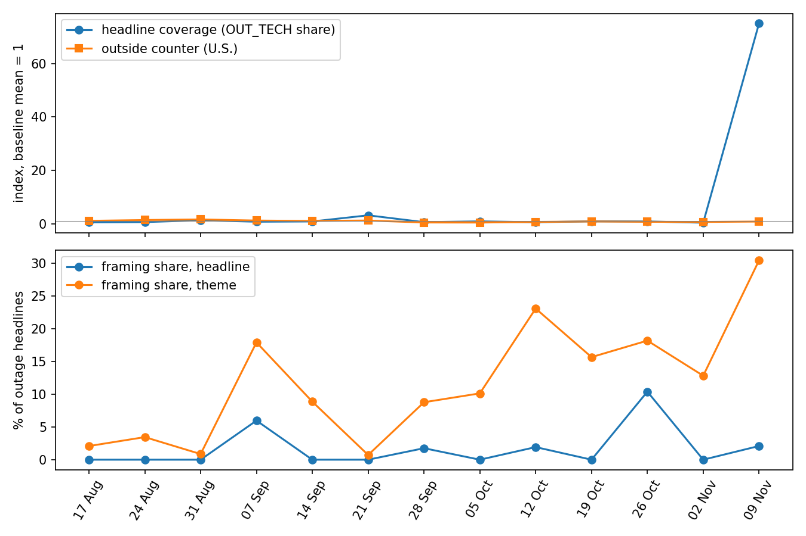

# The news wave: fourth round, the bulk table

Wednesday 18 November 2026, 19:00 UTC. The protocol is `PROTOCOL-4.md`, committed and pushed (`c8bc461`) before any title or theme was counted. The script, `bulk_analyze.py`, was committed (`5ca1e66`) before it was pointed at the table, and run at 18:42 UTC. Every number below is printed by `.venv/bin/python measurements/bulk_analyze.py`; its output is saved in `bulk_analyze-output.txt` and the daily counts in `bulk_series.csv`. Nothing here is on `main`.

This is a headline-and-metadata measure. It counts titles and GDELT's machine-assigned themes, not article text, and is a different instrument from the third round's. The third round's own series is in hand and has not been analysed; see the last section.

## Where things stand

| Rate | Counter | What it says |
| --- | --- | --- |
| Events | The outside counter, `a_instrument.csv` | Down 13% in the week of the pair: 282 U.S. outages against a twelve-week mean of 323. A weak witness, as `RESULTS.md` found. |
| Coverage | Outage headlines in the bulk table | Up about 75-fold in the week of the pair, and still far above baseline on 16 and 17 November. |
| Framing | Share of outage headlines that reach for an attack | In the headline itself, about 2%, little changed on the loose pattern. In the article under it, by GDELT's theme, 30%, about four times baseline. |
| What one reader sees | Not measured | Nothing. |

In the vocabulary of `PROTOCOL-3.md`, that is the middle row: a news wave, with coverage outrunning the event count. The event count here is the weak one, so a real cluster is not ruled out by this round. That is the job of the second round's counted events, which have not been run.

## The table

GDELT's Global Knowledge Graph, English feed, 17 August to 18 November 2026: 8,969 files, 9,003,620 rows, no missing 15-minute slot. Its provenance is in `gdelt-local/data/REPORT.md` and `manifest.csv`, which are not in git. The three gates passed and are recorded in `HANDOFF.md`.

The primary population is U.S. sources with a title: 4.7 million rows. Every statistic was also run over all countries, and over distinct titles so that a syndicated story counts once.

## 1. Outage headlines

`OUT_TECH`: a title that says "outage", "outages" or "ground stop" and none of the electricity and weather words.

| | Twelve baseline weeks | 9 to 15 November | Against baseline |
| --- | --- | --- | --- |
| U.S., rows | 39 to 279, mean 86 | 6,121 | rank 1 of 13 |
| U.S., share of all headlines | 0.011% to 0.077%, mean 0.024% | 1.81% | 75 times the mean |
| U.S., distinct titles | 35 to 129, mean 60 | 2,107 | rank 1 of 13 |
| U.S., share of distinct titles | mean 0.028% | 1.00% | 36 times the mean |
| All countries, rows | 82 to 565, mean 226 | 9,739 | rank 1 of 13 |
| All countries, share | mean 0.033% | 1.51% | 45 times the mean |

By day, U.S. rows:

| Day (Nov) | 9 | 10 | 11 | 12 | 13 | 14 | 15 | 16 | 17 |
| --- | --- | --- | --- | --- | --- | --- | --- | --- | --- |
| Outage headlines | 5 | 8 | 4 | 305 | 1,555 | 3,485 | 759 | 1,524 | 1,773 |
| Distinct titles | 5 | 8 | 4 | 103 | 595 | 1,099 | 293 | 567 | 668 |
| Share of all headlines | 0.01% | 0.01% | 0.01% | 0.54% | 2.75% | 10.97% | 3.33% | 3.06% | 2.91% |

On Saturday 14 November, one U.S. headline in nine in this table was an outage headline.

The registered z-scores are +101 on the share and +94 on the count. They are reported because the protocol says so. Twelve quiet weeks cannot calibrate a jump of this size, and the number should not be read as a probability. The rank and the counts are the summary.

Removing electricity by GDELT's theme instead of by title words (`OUT_TECH_TH`) gives the same picture: baseline mean 117 rows a week, 6,198 in the target week.

## 2. Attack headlines

`ATT_T`: a title with "cyberattack", "cyber attack" or a form of "hack".

| | Twelve baseline weeks | 9 to 15 November | Against baseline |
| --- | --- | --- | --- |
| U.S., rows | 378 to 1,667, mean 847 | 683 | rank 7 of 13, z = −0.4 |
| U.S., distinct titles | 209 to 554, mean 350 | 408 | rank 4 of 13, z = +0.5 |
| All countries, rows | 704 to 3,730, mean 1,650 | 1,501 | rank 6 of 13, z = −0.2 |

An ordinary week for attack headlines. The two days after it are higher: 17 November has 295 U.S. rows, 0.49% of headlines against a baseline daily mean of 0.22%. That is the day after a real attack was found, the website compromise of 16 November, which the protocol said would raise this count honestly.

## 3. The headline framing share

Of outage headlines, the share whose title also reaches for an attack.

| U.S., rows | Baseline, pooled | 9 to 15 Nov | 13 to 17 Nov | Target week against the twelve |
| --- | --- | --- | --- | --- |
| `BOTH_T` (attack or hack) | 1.35% (14 of 1,034) | 2.09% | 1.69% (154 of 9,096) | rank 3 of 13, z = +0.1 |
| `BOTH_T_STRICT` (cyberattack only) | 0.29% (3 of 1,034) | 2.01% | 1.57% (143 of 9,096) | rank 1 of 13, z = +2.1 |

The comparison carried over from part N2: from 2 to 12 November, 0 of 361 U.S. outage headlines reached for an attack; from 13 to 17 November, 154 of 9,096 did.

By day, U.S. rows, `BOTH_T` over `OUT_TECH`: 0/5, 0/8, 0/4, 0/305 on the 9th to the 12th; then 14/1,555, 113/3,485, 1/759, 3/1,524 and 23/1,773 on the 13th to the 17th.

Read with care:

- The strict z-score rests on three baseline headlines in twelve weeks. At least half the baseline weeks have none (the weekly median is zero), so the baseline spread is close to zero and a small share looks large against it.
- The loose pattern's baseline is noisier because "hack" is noisier: one baseline week reaches 10.4%.
- Saturday the 14th supplies 113 of the week's attack-framed outage headlines, and they are 64 distinct titles. Syndication is doing much of this.
- A headline that says officials rule out a cyberattack counts the same as one that alleges it.

So the headline evidence is: about one outage headline in fifty reached for an attack once the ground stop had happened, and none of 361 did in the eleven days before. Whether one in fifty is high cannot be told from a baseline with three examples.

## 4. The theme framing share

Of outage headlines, the share whose article GDELT tagged with a cyberattack theme. This is the nearest the table comes to "the article mentions it".

| | Baseline, pooled | Baseline weeks | 9 to 15 Nov | 13 to 17 Nov | Target week against the twelve |
| --- | --- | --- | --- | --- | --- |
| U.S., rows | 7.9% (82 of 1,034) | 0.7% to 23.1%, median 9.5% | 30.4% | 34.0% (3,091 of 9,096) | rank 1 of 13, z = +2.7 |
| U.S., distinct titles | 8.8% (63 of 719) | 1.3% to 19.1%, median 10.6% | 26.9% | 33.9% (1,091 of 3,222) | rank 1 of 13, z = +2.6 |
| All countries, rows | 7.3% (198 of 2,709) | 0.7% to 35.2%, median 6.5% | 33.8% | 36.1% (4,744 of 13,130) | rank 2 of 13, z = +2.7 |

By day, U.S. rows: 1/5, 2/8, 0/4 and 4/305 on the 9th to the 12th; then 462/1,555, 1,164/3,485, 230/759, 665/1,524 and 570/1,773.

The Microsoft outage's first day, the 12th, shows almost none of it: 4 of 305. From the ground stop on, about a third of outage stories carry the theme, and it does not fade by the 17th.

The loose and strict theme lists give identical counts in every cell. A check after the run found why: across the whole table the looser themes occur without `CYBER_ATTACK` in 541 rows of 9 million, and in no outage headline.

What this does not say: that a third of outage stories alleged an attack. The theme marks a mention, by rules that were not examined here. A story quoting the denial earns it.

## 5. The multiplier

(Target week's coverage ÷ baseline mean) ÷ (target week's outside count ÷ baseline mean).

| | Coverage ratio | Outside counter ratio | Multiplier |
| --- | --- | --- | --- |
| U.S., rows | 75.0 | 0.873 | 85.9 |
| U.S., distinct titles | 36.2 | 0.873 | 41.5 |
| All countries, rows | 45.0 | 0.873 | 51.6 |
| All countries, distinct titles | 28.1 | 0.873 | 32.2 |

Coverage rose by a factor of 28 to 75, depending on how it is counted, in a week when the only fixed counter in hand fell. As `PROTOCOL-3.md` required, the caveat goes beside the number: `RESULTS.md` found that this counter does not rise in weeks with a known major outage. The multiplier shows that coverage and this counter came apart. It does not show that events were flat.

## 6. What the exclusion removes

| U.S. | Baseline | 13 to 17 Nov |
| --- | --- | --- |
| `OUT_TECH` as a share of all outage headlines | 31.5% | 97.8% |
| `OUT_TECH_TH` as a share of all outage headlines | 42.6% | 99.0% |

In an ordinary week two thirds of "outage" headlines are about electricity or weather. In the after period almost none are. The word changed its meaning for a week.

## 7. Against the search API

Descriptive only.

- The search API returned 69 of the 93 days. On 57 of them its count of all articles was at least 20% of its median.
- Over those 57 days, the rank correlation between its daily `OUT_IT` share and this table's daily `OUT_TECH` share is +0.21.
- Its totals for 13, 14 and 15 November are 5,213, 3,545 and 1,819. This table has 56,628, 31,770 and 22,796 U.S. rows with a title on those days.

The two instruments measure different things, full text against titles, so a modest correlation was expected. One this low, together with the API's missing days, says the API's series should not be leaned on for this period.

## Departures from `PROTOCOL-4.md`

1. **A bug in statistic 5, fixed after the first run.** The first run printed the multiplier from the distinct-title share only (41.5 for the U.S.), where the protocol names the coverage of statistic 1, whose first form is all rows. The script now prints both. The rerun's `bulk_series.csv` was byte-identical to the first, and only the lines of section 5 changed. The fix is not in commit `5ca1e66`.
2. **Gate 2 was judged from addresses.** Each of the 20 titles was compared with its URL; no page was opened. One URL is a bare number and could not be judged.
3. **One query outside the protocol, after the run.** The count of rows carrying each attack theme over the whole table, to explain why the loose and strict theme lists agreed. No dates, no titles.
4. **A choice the protocol left open.** For the distinct-title version of a share, the denominator is the number of distinct titles in the population that day, and a week is the sum of its days. A title that runs on two days counts on both.
5. **The script commit was local when the script ran.** The protocol and the patterns were pushed beforehand; the script was committed but not yet pushed.

## What this round cannot say

- **Which story.** `OUT` includes "ground stop", and the ground stop was one event. The rise is the coverage of this week's events, which is the thing being measured, but the table was not split into "outage" and "ground stop" headlines, and no such split was registered.
- **Events.** Nothing here counts failures. The second round's part B2 does, and it has not been run.
- **Claims.** A word in a headline, or a theme on an article, is not an assertion.
- **Readers.** A headline in the table is not a headline anyone saw.
- **Distinct stories.** Outlets append their names to titles, so distinct-title counts run high, and the true number of separate stories is lower than 2,107.
- **U.S. outlets missing from the 2018 lookup.** The all-countries figures bound the effect; they tell the same story with smaller ratios.

## The third round, still owed

`nw_series.csv` holds the search API's five answers and has not been analysed. `nw_analyze.py` should be run and `RESULTS-3.md` updated with its registered statistics, with the 24 missing days and the collapsed totals stated beside every number, and with the two departures from the gate rule that produced the data. Its results stand beside these; neither replaces the other.
